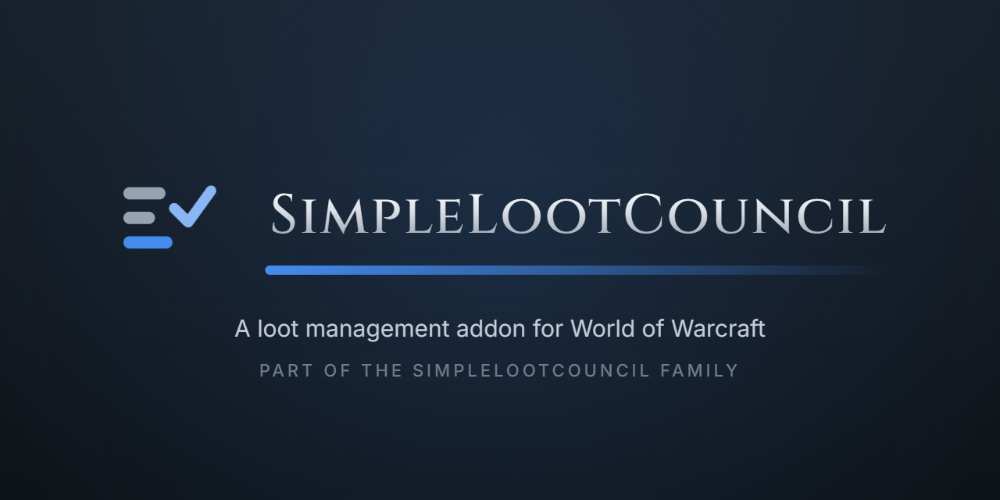
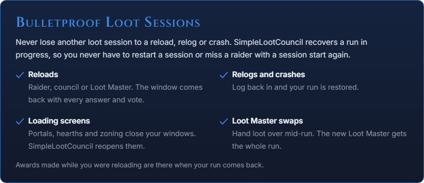

  
  
  
  

**SimpleLootCouncil** is a loot council for **Retail and Forever** raids. Where there is no Master Looter, the council votes on items sitting in a raider's bags inside the four-hour trade window. Raiders answer, the council votes, the Loot Master awards, and the holder's trade window fills itself.

## Built for Retail Loot and WoW Forever

Votes happen on items still inside their trade window. When an item is awarded, its holder is told, and opening a trade with the winner fills it automatically. An award only counts as **delivered** once the item has actually changed hands.

On **WoW Forever**, the Master Looter loot method is back. The Master Looter is the Loot Master: the drop goes to their bags, the council votes the same way, and a trade hands it to the winner.

## Light on Screen Space

SimpleLootCouncil gives you compact frame options for the council voting frame and the loot response frames, taking up less screen real estate, making it easier to keep playing while managing loot.

## Performant at Any Scale

Answers from a 40-player raid cost about 0.04 ms each, so a full raid's answers never stall your game, and closed windows cost almost nothing.

## Bring Your History

Import award history from RCLootCouncil or Loothing by pasting a CSV export, so your council isn't starting blind.

## Features

- Live council voting
- Custom response buttons
- Council by name or guild rank
- Loot from council members' bags, with sessions the council can request or start
- Loot Master promotion, remembered for your next raid
- Autopass on unusable gear
- Equipped-gear and tier-set comparison
- Bonus-roll tracking
- Rolls, asked or generated
- Whisper answers for players without the addon
- Raid team view by guild rank
- Attendance
- CSV export
- WowUtils, Guilds of WoW and wowaudit wishlist support
- SimulationCraft export
- Settings search, window opacity and window scale

## Languages

SimpleLootCouncil runs on every World of Warcraft client language: rolls work in every language, plurals and punctuation follow your language, and Cyrillic, Korean and Chinese text draws in the right font.

English (enUS, enGB) · Deutsch (deDE) · Français (frFR) · Español (esES, esMX) · Italiano (itIT) · Português (ptBR) · Русский (ruRU) · 한국어 (koKR) · 简体中文 (zhCN) · 繁體中文 (zhTW)

The interface is translated into every language above. Not every translation has been checked by a native speaker yet, so translators are deeply desired, and any interested parties are encouraged to join the [Discord](https://discord.gg/simplelootcouncil)!

## Getting Started

Install it from [CurseForge](https://www.curseforge.com/wow/addons/simplelootcouncil) or [Wago](https://addons.wago.io/addons/simplelootcouncil), or with WowUp: **Install from URL** with this repo's address. Everyone who takes part needs it. The group leader is the Loot Master by default. Add your council with `/slc council add Name-Realm`, and type `/slc` for settings or `/slc help` for every command. The [feature guide](https://simplelootcouncil.github.io/) covers the rest.

## Support

Found a bug? Type `/slc log level verbose`, make it happen again, then [open an issue](https://github.com/SimpleLootCouncil/SimpleLootCouncil/issues/new/choose) with your version and what `/slc log` shows.

SimpleLootCouncil is free. If it saves your raid some arguing, you can support its development on [Ko-fi](https://ko-fi.com/laxxz).

## AI Use

Claude and Codex were used in the development of this Addon with a custom built Addon development tool constructed from Blizzards API patch notes.

No code from other loot addons.

## Check out [SLCLauncher](https://github.com/Laxxzz/SLCLauncher) to set and forget all your wow related applications, and have them close when wow does if you want!

## Licence

All rights reserved - see [LICENSE](LICENSE). You are welcome to use the addon;
redistributing it or reusing its source needs a word first.

https://www.curseforge.com/wow/addons/simplelootcouncil

https://addons.wago.io/addons/simplelootcouncil
